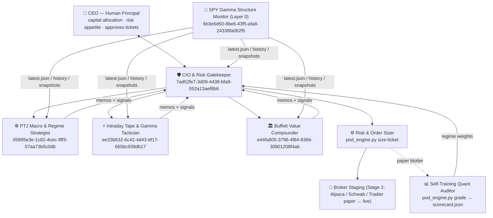

# Horsey Agent Pod — CEO Architecture Manual

> **Paper / Architecture Demo — Not Live Financial Advice.** All times Central Time (CT, America/Chicago).
> Live dashboard: <https://brahaymin.github.io/horsey/#pod> · Engine: [`scripts/pod_engine.py`](../scripts/pod_engine.py) · Roster: [`pod/roster.json`](../pod/roster.json)

## 1. Executive Org Chart



| Agent | ID | Layer | Timeframe | Mandate | Hard limits |
|---|---|---|---|---|---|
| **CEO (Human Principal)** | — | Principal | — | Steers capital allocation, risk appetite, approves staged tickets; zero manual math under stress. | Final yes/no on every live order |
| **CIO & Risk Gatekeeper** | `7ad52fe7-3d09-4438-bfa9-552a13aef8b6` | 2 | all | Synthesizes specialist memos, weights them by `pod/scorecard.json`, enforces the 50-Mistakes Pre-Trade Risk Firewall, runs `pod_engine.py` to produce pre-sized bracketed Order Tickets. | 0.5% default risk, 1.0% cap, halved when VIX > 25 or in drawdown |
| **SPY Gamma Structure Monitor** | `6b3e6d50-8be6-43f5-afa8-24338fa062f5` | 0 | hourly 8:00 AM–3:00 PM CT + post-close | Writes verified `latest.json`, `history/timeseries.jsonl`, `snapshots/`. | Zero directional bias — data only |
| **PTJ Macro & Regime Strategist** | `05895e3e-1c82-4cec-9ff3-07aa73b5c0db` | 1 | days–weeks | 200-day SMA boundary (`$730.15`), VIX9D/VIX/VIX3M term structure, ^SOX vs ^BKX stress. | Only ≥ 5:1 asymmetric setups |
| **Intraday Tape & Gamma Tactician** | `ee33b632-6c42-4d43-bf17-665bc939db17` | 1 | minutes–5 days | Schwartz + Raschke + Kotegawa (BNF) + Cohen 40/30/30: 0DTE–5DTE walls, `$735`/`$760` nodes, RVOL, opening-range pivots, mechanical time stops. | ≥ 3R, time stop mandatory |
| **Buffett Value Compounder** | `e44fa805-3796-4f84-8366-30901208f4ab` | 1 | years | Intrinsic-value watchlist (moat, ROIC, FCF yield, fortress balance sheet); buys at 25%–35% margin of safety in panics; checks `wash_sale_tracker_v2.py`. | Tranches of 1/3; wash-sale check |
| Risk & Order Sizer (engine) | — | tool | — | `pod_engine.py size-ticket` — deterministic 6-point firewall + OCO bracket sizing. | Rejects tickets without a valid stop |
| Self-Training Quant Auditor (engine) | — | tool | — | `pod_engine.py grade` — realized R + Brier, exponential-smoothed regime weights. | Objective math only |

**How you interact:** day-to-day you talk **only to the CIO & Risk Gatekeeper**. It reads every specialist, resolves conflicts using the scorecard, and hands you a short brief plus pre-sized tickets that say *exactly* how many shares/contracts, where the stop is, and when to quit. You can still open any specialist directly from the sidebar when you want the raw reasoning (e.g. ask the Buffett agent to defend a watchlist name).

## 2. Why 5 Focused Agents Beat 1 Giant Prompt

1. **No context pollution.** A 0DTE gamma trader needs 30-minute bars and strike-level OI; a Buffett analyst needs 10 years of free cash flow. Stuffing both into one prompt dilutes both and burns the context window on irrelevant data.
2. **No timeframe confusion.** The #1 way traders blow up is turning a failed day trade into an "investment." Separate agents with separate horizons and separate stops make that structurally impossible — the tactician *must* exit at its time stop; the value agent never sees intraday noise.
3. **No emotional anchoring between styles.** One mind that just argued "panic = opportunity" (Buffett) will under-weight "never fade a short-gamma trend" (Schwartz). Separate agents disagree openly, and the CIO weighs them with data.
4. **Accountability.** Each agent's calls are logged under its own ID and graded separately, so you learn *which lens works in which regime* instead of averaging everything into mush.
5. **Mirrors a real pod shop.** Millennium/Citadel-style pods: specialists generate ideas, a central risk function sizes and vetoes, the PM (you) allocates capital.

## 3. Recommended Missing Pieces (Execution Hesitation & Self-Training)

### A. Pre-Trade Execution & Broker Staging Desk
`pod_engine.py size-ticket` → `pod/ledger/paper_blotter.jsonl` → Broker API.

Hesitation (like not firing the `$760` puts with the order ready) happens when the decision, the math and the click all land on you at the same moment under stress. The fix is to **decide before the trigger**: every idea arrives as a ticket that is already sized, bracketed, firewall-checked and time-stopped — you only confirm a pre-agreed plan.

- **Stage 1 — Live today ($0):** Pre-sized bracket Order Tickets + Paper Blotter. Tab 6 of the dashboard has the same calculator in the browser (2-second sizing). Example:
  ```bash
  python3 scripts/pod_engine.py size-ticket --symbol SPY --instrument option_put \
    --strategy-agent ee33b632-6c42-4d43-bf17-665bc939db17 --equity 50000 \
    --entry 1.85 --stop 1.25 --time-stop "45m if no follow-through" --underlying 733 --stage-paper
  ```
  → VIX 28.18 halves risk to 0.25% = $125 → **2 contracts**, $120 actual risk, OCO stop 1.25, T1 3.65 (3R), T2 4.85 (5R), 45-min time stop, firewall 6/6 ✅.
- **Stage 2 — Recommended next ($0 free API):** connect one broker API. **Alpaca** (free paper + live stocks & options API) is the fastest start; **Charles Schwab Developer API** or **Tradier** if you already hold accounts there; **Interactive Brokers TWS API** for the most coverage. Why these: **one free key gives BOTH real-time WebSocket quotes/options** (plugs straight into `js/feed-adapter.js` / `SPYGammaFeed.applyLiveTick`) **AND staged OCO bracket orders** — first in a free paper account to build the track record, then human-confirmed 1-click live staging (the CIO stages; you press confirm). Never give an agent unattended live-send rights.
- **Stage 3 — Later:** auto-stage from approved tickets with hard daily loss limits and a kill switch.

### B. Deterministic Quant Auditor (`pod_engine.py grade` + `pod/scorecard.json`)
Real self-training means an objective scorekeeper, not LLMs grading their own homework (they rationalize). Every signal is logged with entry, stop, target, probability and horizon. When the horizon elapses, `grade` replays `history/timeseries.jsonl`, records `hit_target` / `hit_stop` / time exit, the **realized R-multiple** and the **Brier error** `(probability − outcome)²`, then updates per-regime weights:

`w_regime ← 0.8·w_regime + 0.2·skill`, `skill = clip(1 + 0.5·clip(R,−1,2) + (0.25 − brier), 0.25, 2.0)`

Effective weight = mean of the currently active regime weights (`short_gamma_backwardation`, `positive_gamma_contango`, `below_200sma`), normalized across specialists. Hot, well-calibrated agents gain influence *in the regimes where they earn it*; cold agents get throttled automatically.

**Optional future agent — Earnings/SEC Filing Catalyst Scout:** uses free SEC EDGAR APIs (`data.sec.gov` submissions & XBRL company facts) to flag 10-K/10-Q/8-K filings, insider Form 4s and earnings dates for the Buffett watchlist and for event-risk blackouts on the tactician.

## 4. Daily CEO Operating Rhythm (CT)

| Time (CT) | What happens | Your job |
|---|---|---|
| **8:00 AM** | Gamma Monitor first hourly snapshot | — |
| **8:15 AM** | **Pre-market CIO brief** (`pod_engine.py status`): regime, risk throttle, each specialist's stance, pre-sized conditional tickets | Approve/veto the day's risk budget (2 minutes) |
| 8:30 AM–3:00 PM | Hourly snapshots; **inflection alerts** only when a conditional trigger fires (e.g. 200-SMA break, $735 reclaim) — arrives as a ready ticket | Confirm or skip; no math |
| **3:15 PM** | **Post-close summary**: blotter P&L in R, `pod_engine.py grade`, scorecard weight changes | Read; adjust risk appetite |
| Weekly | Scorecard review; Buffett watchlist refresh | Reallocate capital between lenses |
